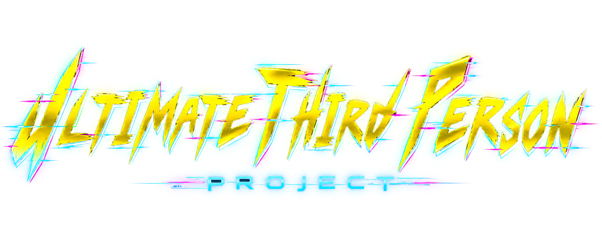
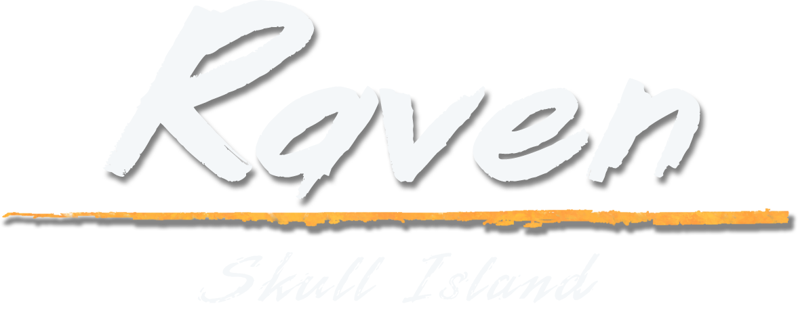

  

I build games and gameplay systems, create digital art, and develop mods. My work brings together programming, animation, and visual design.

<a href="https://www.artstation.com/danielmaciejpytel">ArtStation</a> &nbsp;·&nbsp; <a href="https://www.linkedin.com/in/danielmaciejpytel/">LinkedIn</a>

<h2><code>./projects</code></h2>

<table width="100%">
  <tr>
    <td width="29%" align="center" valign="middle">
      
    </td>
    <td width="71%" valign="top">
<h3><code>utpp</code> / Cyberpunk 2077 mod</h3>

A third-person gameplay and animation framework for Cyberpunk 2077, combining Motion Matching locomotion, camera coordination, aiming, and combat.

<ul>
  <li>Motion Matching locomotion and coordinated character/camera behavior.</li>
  <li>Third-person aiming, weapon handling, and combat animation.</li>
</ul>

<code>C++</code> <code>RED4ext</code> <code>redscript</code> &nbsp; <a href="https://github.com/danielmaciejpytel/uttp">Open repository →</a>

    </td>
  </tr>
</table>

<table width="100%">
  <tr>
    <td width="29%" align="center" valign="middle">
      
    </td>
    <td width="71%" valign="top">
<h3><code>erling</code> / Unreal Engine portfolio prototype</h3>

A stylized football playground and modular character creator built in Unreal Engine, with physics-based ball interactions, custom animation, and a layered facial-expression system.

<ul>
  <li>Foot-aware dribbling, charged shots, and physics-based ball interactions.</li>
  <li>Modular characters, animated layered faces, and UMG menus and HUD.</li>
</ul>

<code>Unreal Engine</code> <code>C++</code> <code>UMG</code> &nbsp; <a href="https://github.com/danielmaciejpytel/erling">Open repository →</a>

    </td>
  </tr>
</table>

<table width="100%">
  <tr>
    <td width="29%" align="center" valign="middle">
      
    </td>
    <td width="71%" valign="top">
<h3><code>raven</code> / Skull Island</h3>

A third-person action-adventure set on a cursed pirate island. Originally a team graduation project where I was Lead Artist; now continued and modernized by me as a solo developer.

<ul>
  <li>My original role: Lead Artist in a six-person Game Dev School team.</li>
  <li>Current work: solo modernization, gameplay fixes, and visual improvements.</li>
</ul>

<code>Unity</code> <code>C#</code> <code>URP</code> &nbsp; <a href="https://github.com/danielmaciejpytel/raven">Open repository →</a>

    </td>
  </tr>
</table>

<h2><code>./toolbox</code></h2>

<pre><code>engines   Unity · Unreal Engine
code      C# · C++ · redscript
art       Blender
focus     gameplay · animation · modding · visual design</code></pre>

<code>$ connect</code> &nbsp; <a href="https://www.artstation.com/danielmaciejpytel">ArtStation</a> &nbsp;·&nbsp; <a href="https://www.linkedin.com/in/danielmaciejpytel/">LinkedIn</a>

